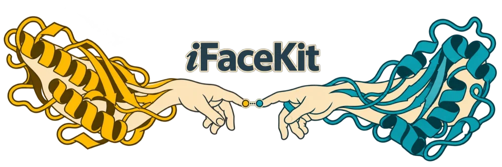

# ifacekit



Interface, contact and clash analysis for PDB and mmCIF models. It looks at
protein, DNA/RNA, ligand and water contacts inside one model. It does not read
or build crystal lattices and does not infer assemblies, so it works the same
for an experimental structure and for an AlphaFold-style prediction.

Runs on Linux and macOS with Python 3.9+. The core analysis needs `gemmi`, `numpy`
and `scipy` only. Nothing needs a license key or a network connection.

## Where to start

* [docs/USAGE.md](docs/USAGE.md): a guide to the commands, with examples (start here)
* [INSTALL.txt](INSTALL.txt): installation, the libcairo library, the web portal, common problems
* [docs/ifacekit_design.md](docs/ifacekit_design.md): how everything is calculated, how it was tested, its limits
* [CHANGELOG.md](CHANGELOG.md) and [CONTRIBUTING.md](CONTRIBUTING.md): what changed, and how to work on the code and make a release

## Double-click start (Windows and macOS)

No command line is needed: in `launchers/` there are files to double-click. `launchers/windows/ifacekit-portal.bat` and `launchers/mac/ifacekit-portal.command` start the web portal on your own computer and open it in the browser;
`ifacekit-check-file.bat` (drop a structure file on it) and `ifacekit-check-file.command` (drag the file into the window) make an HTML report of every chain, and analyse every model of an NMR file.
The first start installs ifacekit into a private Python environment (Python 3.9 or newer and internet needed once). See `launchers/README.txt` for the details and for the security prompts of Windows and macOS.

## Install

Step-by-step instructions for Linux and macOS, the libcairo library, the web portal and common problems are in
[INSTALL.txt](INSTALL.txt). In short:

```
python3 -m venv .venv && . .venv/bin/activate
pip install ".[ligand,pdf,server]"
ifacekit --version
```

The web portal starts with `server/ifacekit-server.sh` and is described in `server/deploy/README_DEPLOY.txt`.
The `data/` and `results/` folders of the archive are empty. The archive holds no structure files: download a public entry from the PDB for a first try (`curl -O https://files.rcsb.org/download/5HPT.cif`).

## Requirements

| Needed for | Software | How to get it |
|---|---|---|
| Core analysis, chain/pair reports, HTML reports (always) | Python 3.9+, `gemmi` (0.6.5+), `numpy`, `scipy` | installed automatically by `pip install .` |
| Ligand interaction report and maps (`--ligand`) | `rdkit` | `pip install ".[ligand]"` |
| PNG and PDF figure files of the ligand maps | `cairosvg` **and** the system library libcairo | `pip install ".[ligand]"`, plus `brew install cairo` (macOS), `sudo apt install libcairo2` (Debian/Ubuntu) or `sudo dnf install cairo` (Fedora/RHEL) |
| Tests | `pytest`, `freesasa`, `rdkit`, `cairosvg` | `pip install ".[test]"` |
| One PDF of all Ramachandran and rotamer plots (`--plots-pdf`) | `cairosvg` (with libcairo) and `pypdf` | `pip install ".[pdf]"` |
| Web portal (`server/app.py`) | `flask`, and `gunicorn` for the production launcher | `pip install ".[server]"` |
| 3D page (`--molstar`) | a web browser with internet access (Mol* 5.0.0 is loaded from jsDelivr) | nothing to install |

Not needed: Phenix, CCP4, the CCP4 monomer library, PISA, MolProbity. The scripts in `tools/` use PISA and
MolProbity output for development comparisons only.

If libcairo is missing, `pip install cairosvg` still succeeds, but ifacekit prints one warning and writes SVG
only (the HTML page and its download buttons still work). Check that the PNG and PDF files exist next to the report.

## Use

You always say what to inspect. With no option the tool only lists the chains
in the file.

```
ifacekit model.cif                         # list chains, then choose
ifacekit model.cif --chains A              # quality of chain A on its own
ifacekit model.cif --chains A C F          # each listed chain, separately
ifacekit model.cif --chains all            # every chain, with a comparison table
ifacekit model.cif --pair A B -o ab.json   # interaction between chains A and B
ifacekit model.cif --all                   # everything in the file
```

* `--chains`: each chain is analysed alone, together with its ligands,
  glycans and waters. These are assigned by structure, not by chain label:
  a ligand or glycan bonded to the chain belongs to it (a glycan tree moves as
  one group), otherwise anything with an atom within 4 A of the chain does, so
  waters or ligands filed under their own chain letter (S, W, L ...) are still
  found. A ligand touching two chains appears in both runs. `--attach label`
  restores the old rule (only residues carrying the chain's own label).
  A chain that holds only ligands or waters cannot be selected. Other chains are not present, so contacts with them never appear.
  The report lists unfavorable and borderline contacts inside the chain.
  With more than one chain a comparison table comes first (residues, atoms,
  unfavorable and borderline pairs, unfavorable per 1000 atoms, possible flips).
* `--pair A B`: only the two chains (with their ligands) plus all waters are
  loaded. The report covers the interface area, the hydrogen bonds and salt
  bridges, contacts that look wrong, buried polar atoms without a partner,
  bridging waters and the most buried residues on each side. Problems inside
  one chain are not reported here, use `--chains` for that.
* `--all`: every chain is a unit and every ligand residue is its own unit.

```python
import ifacekit
ifacekit.list_chains("model.cif")
ifacekit.analyze("model.cif", chain="A")
ifacekit.analyze("model.cif", pair=("A", "B"))
```

### HTML report for designed or predicted complexes

```
ifacekit my_prediction.cif --pair A B --html my_report.html \
    --af3-summary fold_..._summary_confidences_0.json --af3-full fold_..._full_data_0.json
```

One self-contained page with three parts. (1) AI metrics: ipTM, pTM, ranking score, chain-pair ipTM and
minimum PAE from the summary file, plus ipSAE, interface PAE, a PAE heat map (from the full-data file)
and pDockQ. (2) Interface interactions. (3) Quality of the prediction: pLDDT along the sequence, contact
and geometry problems in the whole model. If the AF3 files sit next to the model and carry its name,
they are found without the two options.

For an experimental structure add `--experimental`. The report then has two parts, interface interactions and model
quality, with B-factors in place of pLDDT and no AI metrics. AF3 files are ignored in that mode.

```
ifacekit 5HPT.cif --pair A B --experimental --html 5hpt_A-B_report.html --molstar
```

For a ligand, `ifacekit model.cif --ligand A:V00401 --html lig_report.html [--molstar]` writes a ligand report and the
figures `lig_map_modern` and `lig_map_classic` as SVG, 300 dpi PNG and PDF (needs rdkit; PNG and PDF also need
cairosvg and the system libcairo, see Requirements; without them only SVG is written). The report switches between a modern view and a LigPlot-style view and has
download buttons for SVG, PNG and PDF. The ligand bonds come from the chemical dictionary in the file when it has one
(wwPDB files do), otherwise they are guessed from the coordinates and the page says so. The model type (prediction
or experiment) is detected from the file, and `--experimental` or `--predicted` overrides it. Leave the ID out to use
the first ligand.
Add `--detailed` for a third view in which the residues that hydrogen-bond or salt-bridge the ligand are drawn as chemical
structures (also written as `*_map_detailed` SVG files); the web portal has a check box for it. `--detailed-all` also draws the residues that only have hydrophobic or van der Waals contacts as structures (off by default).

Add `--molstar` to get a second page next to the first one, `my_report_3d.html`. It is the same
report with a 3D panel (Mol*). Click a row in any table (hydrogen bond, clash, issue, buried residue) or a
residue on the pLDDT plot and the panel shows those residues, with a dashed distance line for atom pairs.
The panel also has buttons for all interface residues and for colouring the model by pLDDT. The structure is
embedded in the page. Mol* itself is loaded from a CDN (jsDelivr, version 5.0.0), so this page needs internet.
The plain report does not change and works offline.

### NMR ensembles and other multi-model files

By default only one model of a multi-model file is read (`--model N`, counted from 0). With `--ensemble` every model is analysed. The example is the public NMR entry 9M8X (20 models).

```
ifacekit 9M8X.cif --chains A --ensemble                       # table of all 20 models, mean and sd, then the full report of model 1
ifacekit 9M8X.cif --chains A --ensemble --hydrogens --workers 4 --ensemble-csv ens.csv -o ens.json
ifacekit 9M8X.cif --chains A --models all --html ens.html      # one page: summary and a button per model that swaps the tables (add --molstar for FILE_3d.html with the 3D view)
ifacekit 9M8X.cif --chains A --models 3 --html model3.html     # the report of model 3 (model numbers as in the file, from 1)
ifacekit 9M8X.cif --chains A --models 2-4 --separate --html m.html   # one file per model: m_model02.html, ...
```

The table has one row per model (Ramachandran favored and outlier %, rotamer outlier %, bond and angle RMSZ, heavy-atom contact verdicts, clashes with
hydrogens added when `--hydrogens` is on, and for interfaces the area and the direct hydrogen bonds), then the mean and standard deviation. In the HTML
reports of an ensemble the B-factor or pLDDT plot is replaced by the deviation of every residue from the mean structure (a line with the mean over the models and bands of one standard deviation and of the range; backbone atoms, each chain superposed on its
least mobile 70% of residues), and the Ramachandran and rotamer pages show every model in one plot. NMR models carry no B-factors; a file with an experimental record is never read as a prediction. Details: `docs/USAGE.md`.

### Ramachandran analysis

Every chain-quality run also reports Ramachandran categories (favored, allowed, outlier) for six residue classes
(general, Gly, cis-Pro, trans-Pro, pre-Pro, Ile/Val), using ifacekit's own reference distributions built from
13,115 high-resolution PDB entries (see `ifacekit/data/README.txt` and `tools/rama_reference/`). Nothing external is called.

```
ifacekit model.cif --chains A --html q.html            # HTML quality report (one section per chain)
ifacekit model.cif --chains A --rama-html rama.html     # text report, plus a page with one plot per residue class
```

The pair report has the same analysis for its two chains in the quality section. Compared with `phenix.ramalyze` on
8,815 residues the categories agree for 98.3%; all differences are at the favored/allowed boundary, and the outliers
are identical. Details and limits are in `docs/ifacekit_design.md` section 5.7.

### Rotamer analysis

Chain-quality runs also score every side chain (17 residue-type tables, chi angles as in MolProbity) against ifacekit's own
rotamer reference, built from the same PDB entries: favored, allowed or outlier, with counts, percentages and the outlier list
in the text report, the JSON and the HTML reports (`tools/rotamer_reference/` builds the reference). Against `phenix.rotalyze`
the chi angles agree exactly. The cut-offs were calibrated against rotalyze (900 structures, tests on 300 others): on 293 structures ifacekit found 79%
of MolProbity's rotamer outliers and 84% of its own were confirmed. Every alternate conformer is scored.
Hydrogens are not used. Asn, Gln and His are scored as modelled and flipped, with a flip check from the heavy-atom environment that
only suggests flips (it agrees weakly with Reduce: 29% of its flip suggestions on 2024+ entries were also Reduce flips). The HTML
reports have rotamer plots per residue type (`--rotamer-html FILE` for a stand-alone page). Held-out and comparison results:
`docs/ifacekit_design.md` 5.7 to 5.9.

### Hydrogen bonds without and with water

The pair and ligand reports (and the JSON, field `hbonds`) count hydrogen bonds three ways: **direct** (no water; a donor-acceptor pair of at most 3.3 Å whose geometry is right, no hydrogens needed; the distance-only count is kept as `direct_polar_contacts`), **via water**
(waters bonded to both sides, listed in a table, each checked and marked clear or doubtful) and **connections in total**. A model without waters (an AI prediction) says
that bonds via water cannot be counted. The ligand report draws a **simple** map by default (a water only when it bonds the ligand,
a residue only with a polar contact or two close contacts) and has a switch to **all contacts**; the tables list everything.

### Plots in one PDF

```
ifacekit model.cif --chains A C --html q.html --plots-pdf plots.pdf   # PDF next to the report; the report links to it
ifacekit model.cif --pair A B --plots-pdf plots.pdf                   # the two chains of the pair
```

All Ramachandran and rotamer plots of the chosen chains, with a summary page and outlier lists (needs `pip install ".[pdf]"`).
The B-factor / pLDDT plot along the sequence in the reports colours each chain and shows a thick labelled bar per chain.

### Web portal (internal use)

For a service on a lab server see `server/deploy/README_DEPLOY.txt`: `server/ifacekit-server.sh` (gunicorn), a systemd unit and an nginx
example, limits on simultaneous analyses and memory per analysis, automatic deletion of old jobs, Mol* served by the portal (3D pages work
without internet) and `/healthz`.


```
python server/app.py --port 8000        # then open http://127.0.0.1:8000
```

Four analysis types (for an NMR file with several models, chain quality and experimental interface offer a check box to analyse every model: one page with the ensemble summary and the report of each model): AI-predicted complex (structure plus the AlphaFold summary and full_data JSON files),
experimental interface, ligand binding site, chain quality (all four give an HTML report). A structure is uploaded or fetched by PDB ID from RCSB,
PDBe or PDBj; the page then lists the chains and ligands found in the file. Archives are refused, uploads are checked
(size, plain text, expected content, JSON fields) and stored under their own name reduced to safe characters (an entry fetched by PDB ID as e.g. `8AFB.cif`), so the reports show what was analysed. It uses Flask's built-in server and has
no log-in, so keep it on a trusted network.

## What it computes

* **Units.** With `--chains` and `--pair` a unit is a whole chain (polymer, ligands
  and glycans together). With `--all` each polymer chain is a unit, each ligand
  or ion residue is its own unit and the glycans of a chain form one unit.
  Waters are atoms but never units.
* **Interfaces.** For every pair of units that touch: buried surface area
  (Shrake-Rupley, probe 1.4 A, Bondi radii; area is the mean of the two sides),
  polar fraction, per-residue buried area, buried polar atoms without a
  hydrogen-bond or salt-bridge partner, and waters that contact both units.
* **One atom-pair table for contacts and clashes.** Every non-bonded heavy-atom
  pair within 4.5 A gets a *type* (`hbond`, `salt_bridge`, `hydrophobic`, `vdw`,
  `metal`, `polar_mismatch`, `like_charge`) and a *verdict*
  (`favorable`, `ok`, `borderline`, `unfavorable`) with a short `reason`.
  Pairs up to 1-5 bonds apart are skipped. Between-unit and water pairs are all
  recorded. Ordinary pairs inside one unit are only tallied, unless they are
  borderline or unfavorable (`--all-intra` records everything).
* **Ring interactions.** Stacking, T-shaped and cation-pi for standard residues.
* **Waters and metal sites.** Every water is judged on the whole model, so a
  water whose partners sit on another chain is not called isolated just because
  that chain is not part of the current run. Each water gets a category from
  its polar partners within 3.5 A (`metal_bound`, `well_supported`, `supported`,
  `weak`, `unsupported`) and flags (`too_close`, `ww_close`, `close_carbon`,
  `high_b`, `low_occupancy`). Metal ions get a coordination table with ligand
  count, distance range and, for Mg with six ligands, the deviation from an
  ideal octahedron. Thresholds are provisional.
* **Residue issue list** built from the borderline and unfavorable pairs. A
  `polar_mismatch` that involves an Asn, Gln or His side-chain atom is marked
  `possible_flip`.

The JSON has a `schema_version` so a viewer can rely on its layout.

## Limits you should know about

* **Heavy atoms only, unless `--hydrogens` is given.** Hydrogens in the input are ignored. Hydrogen-bond
  geometry is judged on donor-acceptor distance, not angle. With `--hydrogens` ifacekit places hydrogens on the
  protein itself and adds an all-atom clash check (waters, ligands and nucleic acids get none); only that check
  uses them. It found 79% of MolProbity's clash pairs on 293 structures (alternate conformers left out), and 77% of its own were confirmed.
* **Thresholds are provisional.** They are reasonable starting values and
  have not been calibrated against high-resolution structures. The
  "unfavorable per 1000 atoms" number is **not** a MolProbity clashscore.
* **Guessed roles.** Atoms of ligands and modified residues have no
  donor/acceptor table entry. N and O there are treated as both donor and
  acceptor, flagged `role_uncertain`, and excluded from mismatch rules. The
  report prints a note when this happens.
* **Asn/Gln/His.** A `polar_mismatch` on one of these side chains is often a
  flipped amide or ring, not a real clash.
* **Ramachandran and rotamers** use ifacekit's own references, compared with `phenix.ramalyze` and `phenix.rotalyze` on seven
  structures and tested on held-out 2024+ entries (well-refined residues only). Favored regions are somewhat larger than
  MolProbity's and more rotamer outliers are called. The Asn/Gln/His flip check is weak against Reduce.
* **Not included yet:** rotamer names, shape
  complementarity, PAE-weighted contacts, free-energy estimates, assembly
  prediction.
* **Speed.** About 15 s for an 8000-atom, 5-chain complex. Very large
  assemblies (ribosome scale) have not been tried and will be slow.
* **NMR ensembles** (`--ensemble`, `--models`): every model of the file analysed separately, with the numbers of each model, their mean and standard deviation, the RMSD of every residue over the models, and the full report of the first or of any chosen model.
* **Alternate conformers**: contacts and rotamers are checked for every conformer, the rest uses the first. By default only one model of an NMR
  ensemble is analysed (`--model N` to pick); `--ensemble` analyses every model and gives the numbers of each model, their mean and standard deviation and the full analysis of the first model.

## Tests

```
pip install -e .[test]
pytest
# the tests download a few public PDB entries (about 6 MB) into tests/.pdb_cache the first time;
# without internet they are skipped, or set IFACEKIT_TEST_CACHE to a folder that already holds the files
```

The tests cover the SASA code against an analytic sphere and against
`freesasa` with identical radii, pairwise interface area against `freesasa`,
identical results from PDB and mmCIF versions of the same entry, and each
contact rule on constructed two-atom cases. Real-structure tests are skipped
when the files are absent.

License: MIT (see `LICENSE`), copyright 2026 Kuen-Phon Wu, Institute of Biological Chemistry, Academia Sinica. The version, licence and copyright are shown in the footer of the portal and of every HTML report. Citation is suggested, see `CITATION.cff`.
